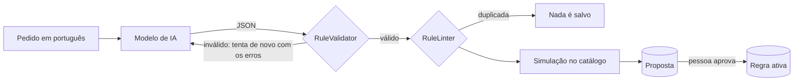

# data-quality-rules


API em **.NET 10** que valida a qualidade de um catálogo de produtos com **regras declarativas em JSON**, e usa **IA generativa** para duas tarefas: transformar um pedido em português numa regra e sugerir correções para produtos com problema. Em nenhum dos dois casos a IA muda algo sozinha.

Cenário fictício: o catálogo de uma livraria, com problemas de cadastro de propósito (livro sem ISBN, preço zero, estoque negativo, produto sem categoria).

## Regras declarativas

Uma regra diz: "quando `when` for verdade, `check` precisa ser verdade".

```json
{
  "name": "ISBN obrigatório para livros",
  "when":  { "field": "category", "op": "equals", "value": "Livro" },
  "check": { "field": "isbn", "op": "required" },
  "severity": "error",
  "message": "Livro sem ISBN."
}
```

- **Operadores:** `required`, `empty`, `equals`, `notEquals`, `in`, `gt`, `gte`, `lt`, `lte`, `regex`, `minLength`, `maxLength`; combinações com `all`, `any` e `not`.
- **Validador** (`RuleValidator`): campo existe, operador combina com o tipo do campo, valor no formato certo, regex compila (e roda com timeout), no máximo 5 níveis de aninhamento. É a mesma porta para regras escritas à mão e pela IA.
- **Revisor sem IA** (`RuleLinter`): compara a regra nova com as ativas e acha **duplicadas**, **contraditórias** (uma exige o campo preenchido e outra vazio) e **faixas impossíveis** (`preço > 50` e `preço < 10`). Regra com conflito não pode ser aprovada.
- **Ciclo de vida:** toda regra nasce como **proposta** e só vale depois de aprovada. Tudo fica no **histórico** (quem propôs, aprovou ou recusou, e o motivo).
- As regras ficam no banco, então mudam sem novo deploy.

## IA generativa

### 1. Regra a partir de texto

```
POST /api/ai/rules   { "request": "ISBN obrigatório quando a categoria for Livro" }
```



A resposta traz a regra, a **simulação** ("reprovaria 2 de 7 produtos: LIV-002, LIV-008") e eventuais conflitos. Pedidos fora do escopo ("escreva um poema") são recusados.

### 2. Sugestão de correção

```
POST /api/ai/fixes/LIV-006
```

A IA sugere valores para os campos envolvidos nas regras que o produto não atende. Cada sugestão passa por três portas antes de ser mostrada:

1. **Campos protegidos** (`sku`, `isbn`, `price`, `stock`) nunca são preenchidos pela IA: inventar um ISBN é pior que deixar vazio.
2. O campo precisa estar **envolvido numa regra que falhou**.
3. Aplicada numa **cópia** do produto, a sugestão precisa **resolver** pelo menos uma regra e **não pode fazer outra regra falhar**.

As sugestões aprovadas pelas portas são só mostradas. Quem grava é uma pessoa, uma por uma (`POST /api/products/{sku}/apply-fix`).

### Cuidados de produção

- **Saída estruturada e validada**, com nova tentativa informando ao modelo o que estava errado.
- **Prompt injection:** o texto do usuário e os dados do produto vão isolados em tags, sem `<`, `>` e caracteres de controle e com tamanho limitado, e o prompt manda tratá-los como dado. Há um teste com um pedido tentando "fechar" a tag.
- **Controle de custo:** cada chamada fica em `AiCalls` com tokens e custo em US$, com limite diário de chamadas e de gasto.
- **Provedor trocável** (`Ai:Provider`): `Off`, `Simulator` (padrão, determinístico, usado nos testes e no CI) ou `OpenAiCompatible` (qualquer API `/v1/chat/completions`, com `response_format: json_object`).

## Outras peças

- **Importação de CSV** (`POST /api/catalog/import`): aceita `;` ou `,`, campos entre aspas, e relata linhas com erro sem perder as boas.
- **Execução de validação** (`POST /api/validation/run`): roda as regras ativas e guarda as violações por produto.
- **OpenAPI** em `/openapi/v1.json` e exemplos prontos em `DataQualityRules.Api.http`.

## Rodando

```bash
dotnet run --project src/DataQualityRules.Api
```

A API sobe em http://localhost:5280, cria o banco SQLite pelas migrations e carrega o catálogo e as regras de demonstração. Abra `src/DataQualityRules.Api/DataQualityRules.Api.http` no VS Code ou no Visual Studio para testar as rotas.

Com Docker:

```bash
docker build -t data-quality-rules .
docker run -p 8080:8080 data-quality-rules
```

Modelo de IA real:

```bash
dotnet user-secrets set "Ai:ApiKey" "sua-chave" --project src/DataQualityRules.Api
dotnet run --project src/DataQualityRules.Api -- --Ai:Provider=OpenAiCompatible
```

## Testes

```bash
dotnet test
```

**45 testes**: cada operador do motor, regras que não se aplicam, validador explicando cada erro, revisor (duplicada, contradição, faixa impossível, escopos diferentes), CSV com aspas e linhas ruins; na IA: texto virando proposta com simulação, nova tentativa com os erros, nada salvo após duas respostas inválidas, pedido fora do escopo, duplicada não salva, tag que não pode ser fechada, limite diário, campo protegido, correção que quebraria outra regra, correção que não resolve nada; e de ponta a ponta pela API: regra da IA só conta depois de aprovada, regra contraditória barrada e histórico com quem fez cada ação.

## Estrutura

```
src/DataQualityRules.Api/
  Rules/      # modelo, motor, validador e revisor de regras
  Catalog/    # produto, importação CSV, validação, ciclo de vida das regras e dados de demonstração
  Ai/         # modelos de IA (real e simulador), regra a partir de texto e sugestão de correção
  Data/       # DbContext e migrations
tests/DataQualityRules.Tests/
```

## Projetos relacionados

- [incremental-sync-worker](https://github.com/ErickGabrielS/incremental-sync-worker): sincronização incremental com IA sugerindo de-para.
- [integration-panel](https://github.com/ErickGabrielS/integration-panel): painel full stack com assistente de IA por function calling.
